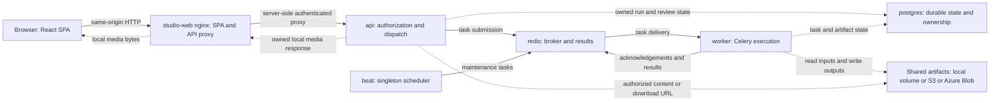
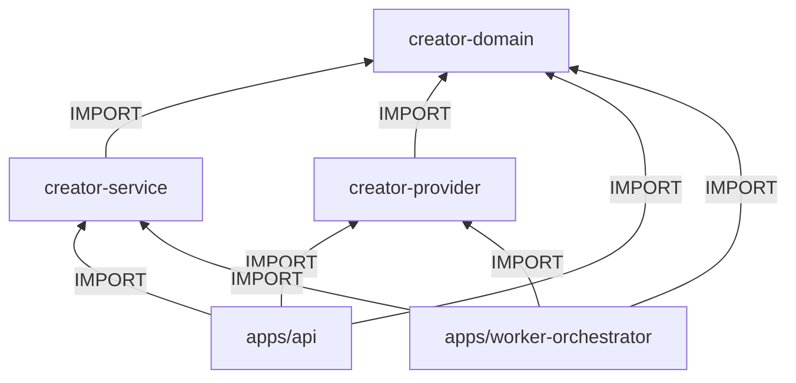

# AI Video Studio

AI-assisted video creation with human review, flexible timelines, and reusable media workflows.

## Overview

AI Video Studio is an open-source, AI-assisted video production studio. Its currently implemented creation workflows focus on short-form videos; end-to-end long-form production remains under development.

The product direction is to turn ideas and media assets into editable short-form
videos: an AI draft first, then scene-level control, a simple timeline, and AI-assisted
editing. These studio capabilities are the target, not a claim that the roadmap
is already implemented.

The current foundation is a stage-based AI production pipeline. It takes an idea
or structured script and produces a video with:

- AI-generated scripts (via LLM)
- Visual plans and image generation (via Stable Diffusion or DALL-E)
- Text-to-speech narration (via local Qwen TTS or ElevenLabs/OpenAI)
- Auto-generated subtitles (via Whisper STT)
- Final video rendering (via FFmpeg)

The pipeline is stage-based with human-in-the-loop review at each step.

> **Current support:** Only `content_format=short` is accepted. A custom target may
> be any finite number greater than zero, but that is an input intent rather than a
> promise that the render will achieve that duration. Longer targets and landscape
> geometry do not make the end-to-end workflow long-form capable. Resumable
> long-form rendering and 10–20-minute acceptance remain open in
> [#884](https://github.com/yeongseon/short-form-studio/issues/884),
> [#885](https://github.com/yeongseon/short-form-studio/issues/885), and the
> [#905 tracking roadmap](https://github.com/yeongseon/short-form-studio/issues/905).

### Validated duration and output contracts

- The Studio and onboarding API offer duration presets **15, 30, 45, 60, and 90
  seconds**, plus Custom. The approximately-three-minute message is guidance, not
  validation. Custom values are rejected only when they are non-numeric,
  non-finite, or not greater than zero; there is no hard maximum.
- Typed project settings accept `short_vertical` (1080×1920), `short_square`
  (1080×1080), and `short_landscape` (1920×1080), all at 30 fps. Encoding choices
  are `preview` (CRF 28/`veryfast`), `standard` (CRF 23/`fast`), and
  `high_quality` (CRF 18/`slow`), using H.264/AAC defaults.
- `legacy_default` is a read-only compatibility result for projects without a
  settings row (vertical, CRF 18/`fast`); it is not a selectable alias for
  `standard`. The persisted choices do **not yet** drive approval/render output,
  so current legacy renders remain vertical until the deferred approval-snapshot
  and worker propagation work lands.

Evidence: `packages/creator-domain/creator_domain/models/duration_preset.py`,
`packages/creator-domain/creator_domain/models/project_settings.py`,
`packages/creator-domain/creator_domain/models/output_spec.py`,
`apps/studio-web/src/__tests__/IdeaFormDuration.test.tsx`,
`packages/creator-service/tests/test_output_preset_ffmpeg.py` (square and
landscape across all three selectable encodings), and
[`docs/adr/008-typed-project-settings.md`](docs/adr/008-typed-project-settings.md).

### Product direction

**Short-first product, long-form-ready architecture.** Short form is a product
constraint, not a core domain constraint. We focus on real assets, scene editing,
a simple timeline, AI editing, and easy OSS setup. Long-form UI, chapters, sequences,
and chunk rendering are not current deliverables.

- [Product direction](docs/PRODUCT_DIRECTION.md) — scope, target experience, and success criteria
- [Roadmap](docs/ROADMAP.md) — planned P0–P3 work and milestone acceptance criteria
- [Media core architecture](docs/architecture/SHORT_FIRST_MEDIA_CORE.md) — generic core, short-first product
- [Future long-form extension](docs/architecture/LONG_FORM_EXTENSION.md) — checklist only, not active work

## Architecture

The project is a monorepo with these main components:

| Component | Path | Description |
|---|---|---|
| **API** | `apps/api/` | FastAPI REST API -- orchestrates the pipeline |
| **Worker** | `apps/worker-orchestrator/` | Celery worker -- runs async AI tasks |
| **Studio Web** | `apps/studio-web/` | React + TypeScript frontend (Vite dev / nginx production) |
| **Domain** | `packages/creator-domain/` | Shared domain models (Pydantic) |
| **Service** | `packages/creator-service/` | Business logic and database layer |
| **Providers** | `packages/creator-provider/` | LLM, Image, TTS, STT provider adapters |

### System Architecture

**Configured base Compose, not verified live hosting.** The concise execution
view and node source map below are separate from the static imports. Solid arrows
are control/API/queue traffic; dotted arrows are persisted data/media I/O.
Media goes through authorized API routes, **not a raw nginx artifact mount**.
See [System Topology](docs/architecture/SYSTEM_TOPOLOGY.md) for the detailed
execution view, optional GPU/monitoring services and local/cloud model choices.

<!-- diagram: runtime-compose -->


| ID | Repository-relative source | Definition |
|---|---|---|
| browser | apps/studio-web/src | React client |
| web | docker-compose.yml#studio-web | nginx SPA/API proxy |
| api | docker-compose.yml#api | FastAPI composition root |
| redis | docker-compose.yml#redis | Celery broker/results |
| worker | docker-compose.yml#worker | Celery executor |
| beat | docker-compose.yml#beat | Maintenance scheduler |
| postgres | docker-compose.yml#postgres | Durable metadata |
| storage | packages/creator-service/creator_service/object_storage.py | Configured local/S3/Azure Blob adapter |

This base view does not apply unchanged to every mode: development uses Vite,
lightweight runs task functions inside the API when REDIS_URL is absent, and
the scaled-workers overlay retains a separate singleton Beat. See the
[mode table and protected hosted contract](docs/architecture/SYSTEM_TOPOLOGY.md#modes-and-hosted-contract).

### Pipeline Flow

These are separate entry flows, not a generated-to-approved-Timeline conversion.
Each named review needs explicit human approval. `PUBLISHED` is an internal
completed-run state, **not a social-platform upload**. Delivery remains authenticated.

```mermaid
flowchart LR
    idea["Idea or script: generated entry"]
    SCRIPT_REVIEW["SCRIPT_REVIEW: approve script"]
    plan["Visual plan: generate scene plan"]
    VISUAL_PLAN_REVIEW["VISUAL_PLAN_REVIEW: approve plan"]
    images["Images: generate assets"]
    VISUAL_ASSET_REVIEW["VISUAL_ASSET_REVIEW: approve assets"]
    audio["Audio and subtitles: TTS and STT"]
    legacy["Legacy render: FFmpeg pipeline inputs"]
    FINAL_REVIEW["FINAL_REVIEW: approve video"]
    PUBLISHED["PUBLISHED: internal completion"]
    idea --> SCRIPT_REVIEW
    SCRIPT_REVIEW -->|"approve-script"| plan
    plan --> VISUAL_PLAN_REVIEW
    VISUAL_PLAN_REVIEW -->|"approve-visual-plan"| images
    images --> VISUAL_ASSET_REVIEW
    VISUAL_ASSET_REVIEW -->|"approve-visual-assets"| audio
    audio --> legacy
    legacy --> FINAL_REVIEW
    FINAL_REVIEW -->|"approve-final"| PUBLISHED
```

<!-- diagram: flow-generated -->


<!-- diagram: flow-timeline -->


```mermaid
flowchart LR
    saved["Saved Timeline R: pre-authored entry"]
    preview["Preview and compile: inspect revision R"]
    TIMELINE_REVIEW["TIMELINE_REVIEW: approve revision"]
    approve["approve-timeline-render: expected_revision=R"]
    persisted["Persisted review: approval bound to R"]
    dispatch["Render dispatch: binds R"]
    reload["Worker reload: SAME R and persisted approval check"]
    ffmpeg["FFmpeg: encode approved revision"]
    FINAL_REVIEW["FINAL_REVIEW: approve video"]
    delivery["Internal PUBLISHED and authenticated delivery"]
    revision_rejection["Revision mismatch: reject and re-preview"]
    saved --> preview
    preview --> TIMELINE_REVIEW
    TIMELINE_REVIEW --> approve
    approve -->|"matching R"| persisted
    approve -->|"revision conflict"| revision_rejection
    persisted --> dispatch
    dispatch --> reload
    reload -->|"same R and approved"| ffmpeg
    reload -->|"revision or approval conflict"| revision_rejection
    revision_rejection --> preview
    ffmpeg --> FINAL_REVIEW
    FINAL_REVIEW -->|"approve-final"| delivery
```

### Package Dependencies

Each arrow is a **static IMPORT dependency**, per
[ADR-001](docs/adr/001-package-dependency-rules.md). Service and provider are
independent; apps compose both. Domain owns shared models/ports and is the leaf.
Service owns use cases/storage; provider owns model adapters.

<!-- diagram: static-imports -->


## Pipeline Stages

Timeline project asset previews stream local/S3/Azure media through the
authorized same-origin API route. Scene/workspace remote previews remain
unavailable (409); final cloud artifact downloads retain authorized redirects.
Cloud SDK provisioning in shipped images remains conditional (see
[Security Model](docs/SECURITY.md#timeline-project-previews)).

```
IDEA_READY -> SCRIPT_GENERATING -> SCRIPT_REVIEW
  -> VISUAL_PLAN_SETUP -> VISUAL_PLAN_GENERATING -> VISUAL_PLAN_REVIEW
  -> VISUAL_ASSET_GENERATING -> VISUAL_ASSET_REVIEW
  -> AUDIO_GENERATING -> SUBTITLE_GENERATING
  -> RENDER_GENERATING -> FINAL_REVIEW -> PUBLISHED
```

Each `*_REVIEW` stage requires explicit approval before advancing.

Pre-authored Timeline projects use `TIMELINE_REVIEW -> RENDER_GENERATING ->
FINAL_REVIEW -> PUBLISHED`. Timeline rendering requires approval of the saved
revision; it does not bypass the generated pipeline's script or visual reviews.

## Quick Start

### Prerequisites

- Docker and Docker Compose v2+
- (Optional) NVIDIA GPU + Container Toolkit for local AI models

### 1. Clone and configure

```bash
git clone https://github.com/yeongseon/short-form-studio.git
cd short-form-studio
cp .env.example .env
# Edit .env as needed

> **Security:** The `.env.example` file contains placeholder passwords. Always change
> `POSTGRES_PASSWORD` and `DATABASE_URL` credentials before running in any shared or
> production environment.
```

### 2. Start services

```bash
docker compose up -d
```

This starts the core services (API, worker, frontend, database, Redis). Local GPU-based AI
services (Ollama, Stable Diffusion, TTS, STT) are optional and gated behind a Docker Compose
profile. To start them alongside the core stack:

```bash
docker compose --profile gpu up -d
```

> **Note:** GPU services require an NVIDIA GPU with the NVIDIA Container Toolkit installed.
> Without a GPU, configure remote AI providers via API keys in `.env` instead — this is the
> simpler path for users without a GPU.
> The `stable-diffusion`, `tts-qwen3`, `stt-whisper`, and `tts-cosyvoice` GPU services are
> optional and require pre-built local images that are **not currently shipped in this
> repository and cannot be reproduced from source**. Expected image names are
> `short-form-studio-stable-diffusion`, `short-form-studio-tts-qwen3`,
> `short-form-studio-stt-whisper`, and `short-form-studio-tts-cosyvoice` with tags like
> `:latest` for local iteration or versioned tags such as `:1.0.0` for reproducible deploys.
> **Development:** `docker compose -f docker-compose.yml -f docker-compose.dev.yml up -d`
> enables backend/worker source mounting and frontend live-reload (Vite dev server on port 5173).

> **Security:** `studio-web` binds to `127.0.0.1:5174` by default so the UI is not exposed on the local network.
> For public deployments, keep this behind an authenticated reverse proxy and add proper application authentication.

### 3. Run database migrations

```bash
docker compose run --rm api alembic upgrade head
```

### 3.5. Bootstrap an API key (first time only)

```bash
docker compose run --rm api python scripts/create_api_key.py \
  --email local@example.com \
  --workspace local \
  --name local-dev
```

This creates a user, workspace, and API key for local development.
The generated key is printed to stdout.

Set that generated value as `API_KEY` in your local `.env`, replacing the
placeholder, then reload the server-side studio proxy:

```bash
docker compose up -d --force-recreate --no-deps studio-web
```

Do not put the key in browser storage or a client bundle. The proxy supplies the
`X-API-Key` header; without this configuration creator requests return 401.

### 4. (Optional) Pull the default LLM model

Only needed when using the `gpu` profile for local AI inference.

```bash
docker compose --profile gpu up -d ollama
# Wait for the container to be healthy, then:
docker compose exec ollama ollama pull qwen3:4b
```

> Skip this step if you use remote LLM providers (OpenAI, Anthropic, Google).

### 5. Open the Studio

Navigate to `http://localhost:5174` to start creating.

## Supported AI Providers

### Local (GPU required)

| Category | Provider | Model |
|---|---|---|
| LLM | Ollama | qwen3:4b |
| Image | Stable Diffusion | SD 1.5 |
| TTS | Qwen TTS | Local |
| STT | Whisper | small (configurable) |

### Remote (API key required)

| Category | Provider | Model | Env Variable |
|---|---|---|---|
| LLM | OpenAI | GPT-4o Mini | `OPENAI_API_KEY` |
| LLM | Anthropic | Claude Sonnet | `ANTHROPIC_API_KEY` |
| LLM | Google | Gemini 2.0 Flash | `GOOGLE_API_KEY` |
| Image | OpenAI | DALL-E 3 | `OPENAI_API_KEY` |
| Image | Stability AI | SD3 Medium | `STABILITY_API_KEY` |
| Image | Google | Imagen 3 | `GOOGLE_API_KEY` |
| TTS | ElevenLabs | Multilingual v2 | `ELEVENLABS_API_KEY` |
| TTS | OpenAI | TTS-1 | `OPENAI_API_KEY` |

## Configuration

See [`.env.example`](.env.example) for all configuration options.

Key settings:

| Variable | Description | Default |
|---|---|---|
| `CORS_ORIGINS` | Allowed CORS origins | `http://localhost:5174` |
| `ARTIFACT_ROOT` | Path for generated artifacts | `./data/artifacts` |
| `ARTIFACT_RETENTION_DAYS` | Days before artifacts are auto-deleted (<=0 falls back to 90; per-row `expires_at = NULL` exempts) | `90` |
| `OLLAMA_DEFAULT_MODEL` | Default LLM model | `qwen3:4b` |

## API Authentication

Creator APIs (`/api/creator/*`) are protected by DB-backed API keys.

Clients must include one of:
- `X-API-Key: <key>` header
- `Authorization: Bearer <key>` header

The key must exist in the `api_keys` table (matched via SHA-256 hash) and be
associated with a user who belongs to at least one workspace.

For multi-workspace users, specify workspace context with:
- `X-Workspace-Id: <workspace_id>` header

Admin APIs (`/api/admin/*`) use a separate `ADMIN_API_KEY` env var and
`X-Admin-Key` header.

## Development

### Backend

```bash
# Lint
python3 -m ruff check apps packages

# Run API locally
cd apps/api && uvicorn shorts_api.main:app --reload
```

> **Reproducibility:** The repository includes a `constraints.txt` file that pins all
> transitive Python dependencies. CI and Docker builds install against it. To regenerate
> after updating dependencies, use `make lock` (runs `uv export --no-hashes -o constraints.txt`).

### Frontend

```bash
cd apps/studio-web
npm ci
npm run dev      # Development server
npm run build    # Production build
npm test         # Run tests
```

### Running Tests

```bash
# Backend tests
python3 -m pytest apps/api/tests/ -x -v

# Frontend tests
cd apps/studio-web && npm test
```

## Lightweight Mode

You can run the pipeline without Celery/Redis for local development.

- If `REDIS_URL` is set, dispatch uses Celery (default behavior).
- If `REDIS_URL` is unset, dispatch runs worker task functions synchronously in the API process.

See [`docs/LIGHTWEIGHT.md`](docs/LIGHTWEIGHT.md) for setup and tradeoffs.

## Service Ports

| Service | Port | Protocol |
|---|---|---|
| API (FastAPI) | 8000 | HTTP |
| Studio Web (Vite dev / nginx prod) | 5174 | HTTP |
| PostgreSQL | 5432 | TCP |
| Redis | 6379 | TCP |
| Ollama | 11434 | HTTP |
| Stable Diffusion | 7860 | HTTP |
| TTS (Qwen) | 8100 | HTTP |
| STT (Whisper) | 9000 | HTTP |
| Flower (monitoring) | 5555 | HTTP |

## Production Deployment

> **The Quick Start section above is for local development only.**
> Production deployments require additional security and infrastructure steps.

### Required for Production

1. **Reverse proxy** (nginx/Caddy/Traefik) with TLS termination in front of the API
2. **`ENVIRONMENT=production`** — enables fail-fast startup validation
3. **Strong `ADMIN_API_KEY`** — minimum 16 characters, enforced at startup
4. **Port binding** — API must stay on `127.0.0.1` (never `0.0.0.0`)
5. **Per-user auth** — for multi-user deployments, add OAuth2/OIDC (see Security docs)

### Scaling

- Use `docker-compose.scaled-workers.yml` for per-queue worker scaling
- Configure `DB_POOL_MIN_SIZE`/`DB_POOL_MAX_SIZE` for connection pool tuning
- Enable OpenTelemetry (`OTEL_ENABLED=true`) for observability

### Full Guides

| Guide | Description |
|-------|-------------|
| [Deployment Checklist](docs/CUTOVER.md) | Step-by-step production cutover |
| [Security Model](docs/SECURITY.md) | Auth, network policy, trust boundaries |
| [Observability](docs/OBSERVABILITY.md) | Tracing, metrics, structured logging |
| [Timeout/Retry Policy](docs/TIMEOUT_RETRY_POLICY.md) | Task timeouts and retry config |


## Documentation

- [System Topology](docs/architecture/SYSTEM_TOPOLOGY.md) -- Configured runtime, static imports, approval flows and hosted contract
- [First Short Walkthrough](docs/FIRST_SHORT_WALKTHROUGH.md) -- Offline demo, explicit Timeline approval, render and download
- [Quick Start](docs/QUICKSTART.md) -- Local bootstrap and server-side authentication wiring
- [Product Direction](docs/PRODUCT_DIRECTION.md) -- Short-first scope and target user experience
- [Roadmap](docs/ROADMAP.md) -- Planned foundations, studio editing, AI editing, and OSS usability
- [Media Core Architecture](docs/architecture/SHORT_FIRST_MEDIA_CORE.md) -- Target architecture and compatibility boundaries
- [Future Long-form Extension](docs/architecture/LONG_FORM_EXTENSION.md) -- Deferred extension checklist
- [Usage Guide](docs/USAGE.md) -- Detailed feature walkthrough
- [Security Model](docs/SECURITY.md) -- Authentication, trust boundaries, network policy
- [Deployment Guide](docs/CUTOVER.md) -- Production deployment checklist
- [Lightweight Mode](docs/LIGHTWEIGHT.md) -- Run without Celery/Redis
- [Local Docker Compose Setup](docs/LOCAL_DOCKER.md) -- Run the full stack on a local server with LAN access

## License

This project is open source. See [LICENSE](LICENSE) for details.

## Contributing

Contributions are welcome. Please open an issue first to discuss what you would like to change.
