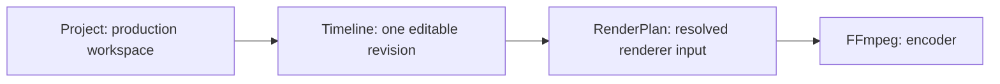
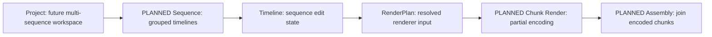

# Future Long-form Extension

**Deferred design checklist only.** Long-form is not in the current product
scope, roadmap, or release acceptance criteria. Do not create long-form issues,
recipes, UI, rendering workflows, or speculative infrastructure from this list.
For actual configured services and revision approval, use the
[current system topology](SYSTEM_TOPOLOGY.md). Neither sketch below is an
execution inventory or a claim of live hosting.

The [current target](SHORT_FIRST_MEDIA_CORE.md) stays simple:

**TARGET simplification**, omitting the current approval gates, not a runtime guide.

<!-- diagram: planned -->

## Boundaries retained now

1. Use generic MediaAsset rather than a short-specific asset class.
2. Do not bake a 60-second or three-minute limit into Timeline domain invariants.
3. Use generic OutputSpec configured by short-oriented presets.
4. Keep RenderPlan independent of short/long product labels, while retaining
   precise timing and operational resource validation.
5. Keep the ContentRecipe schema extensible beyond a mandatory short-only format.

These boundaries reduce future migration cost; they do not imply tested long-form
support or eliminate future design, performance, persistence, and UX work.

## Revisit only after product demand is validated

The following is a future evaluation checklist, **not active implementation work**:

- Add Sequence above Timeline.
- Allow a Project to contain multiple Sequences.
- Add Sequence-level RenderArtifact.
- Add chunk rendering with appropriate retry and resource handling.
- Add final assembly.
- Add long-form recipes.
- Add chapter navigation UI.

Possible future structure:

**PLANNED / DEFERRED**, not deployed:

<!-- diagram: planned -->

At that point, explicitly design migration from Project's single Timeline,
multi-sequence ownership and history, render correctness across chunks, audio and
transition continuity, recovery, and resource limits. None is a prerequisite for
the current short-form workflows. The repository rename is tracked separately in
[#886](https://github.com/yeongseon/short-form-studio/issues/886) (see
[BRANDING.md](../BRANDING.md)) and is not gated on long-form scope.
