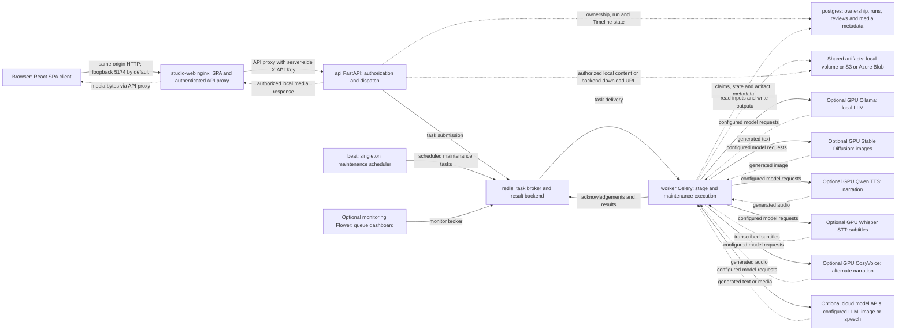
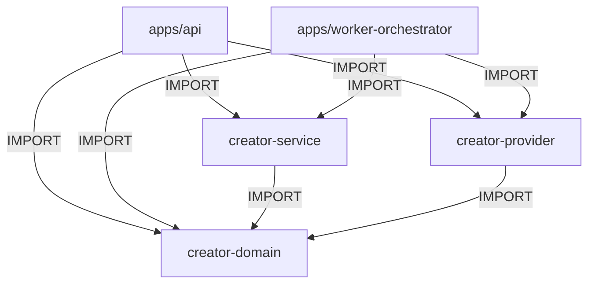

# System Topology

**Status: configuration/contract templates; live hosting not verified here.**
These are source-backed views of the current short-first foundation, not a
discovered live cluster. [ADR-001](../adr/001-package-dependency-rules.md) owns
static dependencies; [media core](SHORT_FIRST_MEDIA_CORE.md) describes target
integration and [long-form extension](LONG_FORM_EXTENSION.md) stays deferred.

## Arrow legend and validation convention

- Runtime solid `-->` arrows mean control: HTTP/API requests, task messages,
  acknowledgements/results or model requests. Redis carries commands/results,
  not video bytes. Dotted `-.->` arrows mean persisted data or media I/O.
- Static arrows mean **IMPORT**, never a request or runtime service call.
- Flow arrows mean stage ordering or explicit commands, not an automatic Celery
  chain. Labels identify human approval and rejection boundaries.
- Every Mermaid fence has an immediately preceding `diagram:` HTML annotation:
  `runtime-compose`, `static-imports`, `flow-generated`, `flow-timeline`,
  `deployment-contract` or `planned`. IDs are unique **within a fence**.
- The bounded syntax is `flowchart`/`graph` with LR/RL/TB/TD/BT direction;
  one `ID["quoted label"]` declaration or one edge per line. Edges use `-->`
  or `-.->` with an optional `|"quoted label"|`. Declare endpoints separately;
  no implicit IDs, chained edges, subgraphs, shapes or styling directives.
- Runtime node tables use `| ID | repository-relative-path#compose-service | definition |`.
  Omit the fragment for source files/directories. Paths are rooted at the repo,
  not this document; Compose fragments are service names, not Markdown anchors.
- Run `python3 scripts/check_architecture_diagrams.py` from any directory. CI
  has **no real Mermaid renderer**: the stdlib checker extracts every fence in
  the seven maintained documents, checks recognized headers, balanced quoted
  brackets via full-statement parsing, IDs, ADR policy, source maps, optional
  profiles, required flows and relative Markdown links/heading anchors. It does
  not prove visual layout, full Mermaid grammar, live routing or provider access.
  GitHub renders these plain-text sources; its renderer was not run here.
- Package edge validation reuses `check_package_dependencies.check_source` and
  `PACKAGES` on synthetic imports. The AST gate scans packages only; app-to-package
  diagram permissions come from ADR-001's composition-root rule. Neither gate
  imports application code. Synthetic negative fixtures prove each rejection.

## Base Compose execution

<!-- diagram: runtime-compose -->

All model/profile nodes are optional configuration choices, not simultaneous
requirements. Four GPU service images are not reproducible from shipped model
source (see README Quick Start). Storage is a configured alternative, **not three
mandatory Compose services**. Beat emits maintenance commands; workers perform
reconciliation, retention and deletion against DB/storage. API/worker share the
artifact bind mount; worker/Beat also share the durable DLQ/broker-epoch volume.

Timeline project asset previews stream local/S3/Azure content through the
authorized same-origin API route. Scene/workspace remote previews remain
unavailable (409); remote artifact download can redirect **after authorization**
to a backend URL (signed where supported). It is
not a raw nginx mount or blanket public bucket grant. The diagram's API→web→browser
media arrows describe authorized streaming; final-artifact redirects remain an alternative.

### Runtime node to source path map

| ID | Repository-relative source | One-line definition |
|---|---|---|
| browser | apps/studio-web/src | React SPA running in the user's browser |
| web | docker-compose.yml#studio-web | nginx serves SPA files and proxies authorized API traffic |
| api | docker-compose.yml#api | FastAPI owns authorization, run/review state and dispatch |
| redis | docker-compose.yml#redis | Celery broker/result backend, with AOF persistence |
| worker | docker-compose.yml#worker | Celery executor for generation, rendering and maintenance |
| beat | docker-compose.yml#beat | Separate singleton scheduler, not a media executor |
| postgres | docker-compose.yml#postgres | Durable ownership, run, task, approval and asset metadata |
| storage | packages/creator-service/creator_service/object_storage.py | Local/S3/Azure Blob storage adapter, selected by STORAGE_BACKEND |
| ollama | docker-compose.yml#ollama | Optional gpu-profile LLM service |
| diffusion | docker-compose.yml#stable-diffusion | Optional gpu-profile image generation service |
| qwen | docker-compose.yml#tts-qwen3 | Optional gpu-profile narration service |
| whisper | docker-compose.yml#stt-whisper | Optional gpu-profile speech transcription service |
| cosyvoice | docker-compose.yml#tts-cosyvoice | Optional gpu-profile alternative narration service |
| cloud | packages/creator-provider/creator_provider | Optional external model API adapters |
| flower | docker-compose.yml#flower | Optional monitoring-profile broker dashboard |

### Runtime arrow evidence

The README is a subset of these same arrows. `depends_on` is startup ordering,
not evidence for every I/O edge; code supplies the latter evidence.

| Node or arrow family | Audited source evidence | What is established |
|---|---|---|
| Browser→web; web→API; API→web→Browser local bytes | `docker-compose.yml:107–119`; `apps/studio-web/nginx.conf.template:10–23,89–109`; `creator_media_content.py:32–69` and `creator_artifact_download.py:51–84,155–160` under API routes | Loopback nginx 5174→8080, same-origin proxy with key, owned local file responses; remote download redirect alternative |
| API→Redis | `apps/api/src/shorts_api/task_dispatch_adapter.py:33–34,76–85` | REDIS_URL selects queue dispatch with apply_async |
| Redis→worker; worker→Redis | `apps/worker-orchestrator/celery_app.py:109,150–167,198–207`; `docker-compose.yml:61–80` | Broker/results and late acknowledgements, separate configured worker |
| Beat→Redis | `docker-compose.yml:90–105`; `celery_app.py:112–120,197` in worker root | Separate scheduler publishes five maintenance schedules |
| Flower→Redis | `docker-compose.yml:245–255` | Optional monitoring profile uses broker URL |
| API→Postgres | `creator_timeline_render.py:36–62,74–103`; `creator_runs_core.py:119–223` under API routes | Owned Timeline lookup, persisted review/state changes |
| Worker→Postgres | `tasks/timeline_render.py:99–125`; `tasks/render_video.py:97–102`; `tasks/generate_script.py:140–145` in worker root | Approved revision reload, script/artifact metadata persistence |
| Worker→storage; API→storage | `docker-compose.yml:45,68`; `tasks/timeline_render.py:135–156`; `tasks/render_video.py:95–102`; `creator_artifact_download.py:76–84,87–125` | Shared local artifacts, materialization/upload, authorized backend download or local stream |
| Worker→all configured model nodes; all model nodes→worker | `tasks/generate_script.py:71–89,140–145`; `packages/creator-provider/creator_provider/registry.py`; `docker-compose.yml:121–243` | Worker composes provider independently of service; requests yield text/media; each GPU profile is optional |
| Storage alternatives | `packages/creator-service/creator_service/object_storage.py:104,182,282,438–450` | Local, S3 and Azure Blob are backend choices, not extra base services |

Relative filenames in this evidence table are qualified by the stated directory;
the node table above provides machine-checked repository-root paths.

## Static import dependencies

The domain is a leaf: ports and shared models. Service owns use cases and storage
adapters. Provider owns model I/O adapters. API and worker are separate application
composition roots, wiring the independent service/provider implementations.

<!-- diagram: static-imports -->

| Static node | Source path | Definition |
|---|---|---|
| API | `apps/api/src/shorts_api/task_dispatch_adapter.py` | Application-owned dispatch wiring |
| WORKER | `apps/worker-orchestrator/tasks/generate_script.py` | Application-owned service/provider composition |
| DOMAIN | `packages/creator-domain/creator_domain` | Models and ports with no internal dependencies |
| SERVICE | `packages/creator-service/creator_service` | Use cases and persistence adapters |
| PROVIDER | `packages/creator-provider/creator_provider` | Local/cloud model adapters |

## Creation and approval

These are **separate entry flows**. Generated runs use legacy rendering; they do
not automatically become approved Timelines. Each review gate requires an explicit
API approval command. Restart/regeneration returns to the corresponding stage.
`PUBLISHED` means internal completed-run state, **not upload to a social platform**.
Authenticated delivery is a route authorization boundary, not proof that a final
status itself grants public access.

### Generated entry

```mermaid
flowchart LR
    idea["Idea or script: generated entry"]
    script["Script generation: LLM draft"]
    SCRIPT_REVIEW["SCRIPT_REVIEW: human script approval"]
    visual["Visual plan: setup and LLM generation"]
    VISUAL_PLAN_REVIEW["VISUAL_PLAN_REVIEW: human plan approval"]
    images["Images: generate visual assets"]
    VISUAL_ASSET_REVIEW["VISUAL_ASSET_REVIEW: human asset approval"]
    audio["Audio and subtitles: TTS and STT"]
    legacy["Legacy render: FFmpeg pipeline inputs"]
    FINAL_REVIEW["FINAL_REVIEW: human video approval"]
    PUBLISHED["PUBLISHED: internal completed run"]
    delivery["Authenticated delivery: owned content or download"]
    idea --> script
    script --> SCRIPT_REVIEW
    SCRIPT_REVIEW -->|"approve-script"| visual
    visual --> VISUAL_PLAN_REVIEW
    VISUAL_PLAN_REVIEW -->|"approve-visual-plan"| images
    images --> VISUAL_ASSET_REVIEW
    VISUAL_ASSET_REVIEW -->|"approve-visual-assets"| audio
    audio --> legacy
    legacy --> FINAL_REVIEW
    FINAL_REVIEW -->|"approve-final"| PUBLISHED
    PUBLISHED --> delivery
```

<!-- diagram: flow-generated -->

### Pre-authored Timeline entry

R is the saved revision, not whatever edit is current when a worker starts.
Preview validates authorized assets and compiles that revision. Approval compares
`expected_revision=R`, persists the review and dispatch metadata, then dispatches.
The worker reloads **the same R** and verifies persisted approval before encoding.
Revision/approval mismatch rejects rendering; re-preview and approve the saved
revision again. Accepting an editor change is not approval to render it.

```mermaid
flowchart LR
    saved["Saved Timeline revision R: pre-authored entry"]
    preview["Preview and compile: authorized assets at R"]
    TIMELINE_REVIEW["TIMELINE_REVIEW: human revision approval"]
    approve["approve-timeline-render: expected_revision=R"]
    persisted["Persisted review: run, Timeline and revision R"]
    dispatch["Render dispatch: metadata binds R"]
    reload["Worker reload: SAME R and persisted approval check"]
    ffmpeg["FFmpeg: materialize and encode approved plan"]
    FINAL_REVIEW["FINAL_REVIEW: human video approval"]
    PUBLISHED["PUBLISHED: internal completed run"]
    delivery["Authenticated delivery: owned content or download"]
    revision_rejection["Revision mismatch or missing approval: reject and re-preview"]
    saved --> preview
    preview --> TIMELINE_REVIEW
    TIMELINE_REVIEW --> approve
    approve -->|"matching R"| persisted
    approve -->|"revision conflict"| revision_rejection
    persisted --> dispatch
    dispatch --> reload
    reload -->|"same R and approved"| ffmpeg
    reload -->|"revision or approval mismatch"| revision_rejection
    revision_rejection --> preview
    ffmpeg --> FINAL_REVIEW
    FINAL_REVIEW -->|"approve-final"| PUBLISHED
    PUBLISHED --> delivery
```

<!-- diagram: flow-timeline -->

| Flow nodes | Source path | Definition / evidence responsibility |
|---|---|---|
| idea, script, visual, images, audio | `apps/worker-orchestrator/tasks/` | Stage task implementations generate drafts/media |
| SCRIPT_REVIEW, VISUAL_PLAN_REVIEW, VISUAL_ASSET_REVIEW, FINAL_REVIEW, PUBLISHED | `apps/api/src/shorts_api/routes/creator_runs_core.py` | Explicit approval targets and internal completion |
| legacy | `apps/worker-orchestrator/tasks/render_video.py` | Selects legacy input unless render_source is Timeline |
| saved, preview, TIMELINE_REVIEW, approve, persisted, dispatch, revision_rejection | `apps/api/src/shorts_api/routes/creator_timeline_render.py` | Compile/revision checks, persisted review and dispatch |
| reload, ffmpeg | `apps/worker-orchestrator/tasks/timeline_render.py` | Same-revision/approval validation and render execution |
| delivery | `apps/api/src/shorts_api/routes/creator_artifact_download.py` and `creator_media_content.py` in the same directory | Ownership-checked delivery, not an external publish operation |

## Modes and hosted contract

| Mode | Configuration / contract | Execution difference |
|---|---|---|
| Base local Compose | `docker-compose.yml` | Loopback studio-web/nginx, API, Redis broker/results, worker and singleton Beat; PostgreSQL and shared local artifacts |
| Development | `docker-compose.dev.yml` | Vite dev server/proxy replaces nginx, loopback port 5173; source mounts/live reload |
| Lightweight | [LIGHTWEIGHT.md](../LIGHTWEIGHT.md) and `task_dispatch_adapter.py` | Without REDIS_URL, bound worker task functions execute synchronously inside the API process; no separate Redis/worker/Beat requirement |
| Scaled workers | `docker-compose.scaled-workers.yml` | Replaces base worker with script/creator, image, audio and render consumers; keeps one separate Beat; this is configuration, not a proven live routing result |
| Protected hosted deployment | [DEPLOYMENT.md](../DEPLOYMENT.md) | Operator-owned authenticated TLS/private ingress and runtime resources, protected environments, exact SHA/digests and preflight; not a discovered Kubernetes/cloud cluster |

Every hosted-contract node below is a release gate or operator responsibility,
not a provisioned service. No commands here enable delivery.

```mermaid
flowchart LR
    hold["Default hold: DEPLOYMENT_ENABLED absent or false"]
    ci["Authorized window: exact-source CI gate"]
    candidate["Candidate images: immutable digests and scans"]
    preflight["Manifest and HTTPS preflight: contracts and real targets"]
    staging["Protected staging: migration, deploy and verification"]
    production["Protected production: migration, deploy and verification"]
    ingress["Operator contract: authenticated TLS ingress and private API"]
    inventory["Operator inventory: DB, broker, scheduler, workers and storage"]
    hold -->|"explicit operator authorization only"| ci
    ci --> candidate
    candidate --> preflight
    preflight --> staging
    staging -->|"verified identities and smoke"| production
    production --> ingress
    ingress --> inventory
```

<!-- diagram: deployment-contract -->

Sequence, chunk rendering and assembly belong only in the
[PLANNED / DEFERRED extension](LONG_FORM_EXTENSION.md), never current topology.
